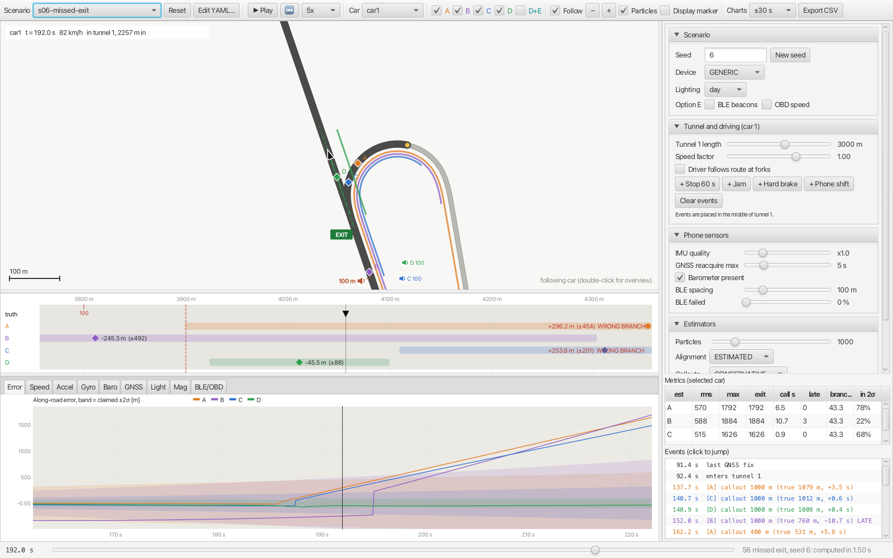
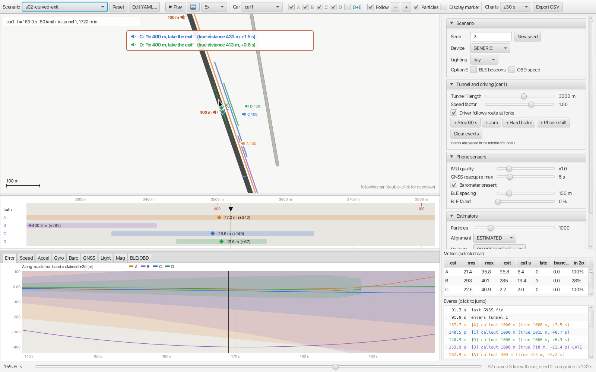
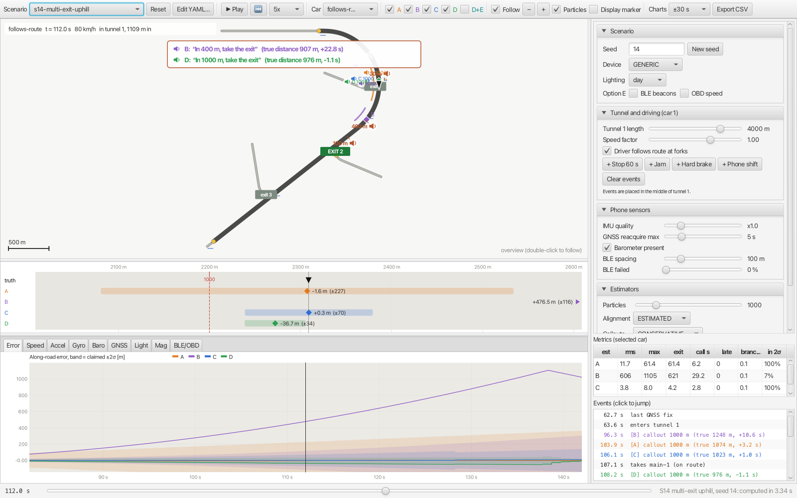

# Through the Tunnel

How do you keep a navigation app's car marker in the right place when GPS disappears in a tunnel
500 m to 5 km long, call out an exit inside the tunnel at the right moment, and recover cleanly at
the end?

This repository contains:
- a **visual simulator** (JavaFX): a road network with tunnels and an in-tunnel exit, cars driving
  through it, and the sensor data their phones record;
- **five estimators** (A to D, plus D+E), shown next to the true position;
- a **batch runner** for Monte Carlo evaluation.



*S6: the route takes the exit inside the tunnel, but the driver stays on the main road. The particle
filter D (green) follows the car onto the main road within about a second. A, B and C stay on the
planned ramp ("WRONG BRANCH") until GPS returns.*

| Document | Content |
|---|---|
| [docs/WRITEUP.md](docs/WRITEUP.md) | Approach, assumptions, what is simulated, results, limitations, next steps with real devices |
| [docs/DESIGN.md](docs/DESIGN.md) | Architecture and design decisions |
| [AI_USAGE.md](AI_USAGE.md) | How AI tools were used, and where they were corrected |

## Quick start

Requirements: **JDK 21 or newer** (tested with 21 and 26). The Gradle wrapper downloads Gradle and
JavaFX on first use. Run commands from the repository root.

```bash
./gradlew :sim-app:run                                 # visual simulator
./gradlew test                                         # unit and regression tests (~15 s)
./gradlew :sim-batch:run --args="single"               # every scenario once, metrics table
./gradlew :sim-batch:run --args="mc -n 50"             # Monte Carlo, 50 seeds per scenario
./gradlew :sim-batch:run --args="study all -n 50"      # all studies behind the write-up (~15 min)
./gradlew :sim-batch:run --args="export scenarios/s02-curved-exit.yaml"   # CSV of every sensor stream
```

## Using the simulator

- **Scenario**: pick one in the toolbar. **Reset** reloads the file. **Edit YAML…** changes any
  parameter. Every change re-runs the whole scenario in the background, typically in 1–3 s. The
  run is deterministic for a given seed, and the playhead keeps its position.
- **Play / speed / timeline**: play at 1–50× or drag the timeline. Clicking an event in the event
  log, or a point on a chart, jumps there.
- **Estimators A, B, C, D, D+E**: toggle visibility. Ticking one that hasn't been computed yet adds
  it and re-runs.
- **Map**: scroll to zoom, drag to pan, double-click to switch between following the car and the
  overview.
  - Black triangle: the true car.
  - Diamonds: estimates. Coloured lines beside the road: each estimate's ±2σ along the road.
  - Dots: particles.
  - Red crosses: recent GNSS fixes.
  - Yellow dots: tunnel portals. Squares: BLE beacons (option E).
  - **Exit announcements**: orange speakers on the left of the road mark where announcements
    *should* be given (1000 / 400 / 100 m before the green EXIT sign). Coloured speakers on the right
    mark where each estimator actually gave them; a red ring means late. When an announcement
    fires, a banner shows it as the driver hears it, with the true distance and the timing error.
    Every exit has a sign on its ramp: grey "exit n", green "EXIT n" for the route's exit.
- **Strip view** (middle): the road straightened out around the car, one row per estimator with its
  signed along-road error and ±2σ. In a single-lane tunnel this error is what matters, and at
  tunnel scale it is invisible on the map. Red dashes mark the fork and the callout distances.
- **Charts**: estimation error with each estimator's claimed ±2σ, and every sensor stream the phone
  recorded. Grey shading marks tunnel time.
- **Parameter panel** (right): seed, device profile (generic Android / iOS / low-end), day or night,
  option E (BLE, OBD), tunnel length, driver speed, whether the driver follows the route, and
  buttons that add a stop, a jam, a hard brake or a phone shift in the middle of the tunnel. Also:
  IMU quality, GNSS reacquisition delay, barometer on/off, beacon spacing and failures, particle
  count, alignment, callout policy, and on/off switches for each aiding source.
- **Metrics** (right): rms and max error inside tunnels, error at the exit, callout timing, late
  callouts, branch decision time, and the share of time the error stayed within the claimed 2σ.
- **Export CSV**: writes truth, sensor logs, estimates and events to `results/export/`.



*S2, 1.5 s after the 400 m announcement. The planned point is on the left of the road. On the
right, the constant-velocity estimator A announced 115 m early, the EKF C 33 m early and the
particle filter D 13 m early. The banner shows what the driver hears.*



*S14 overview: three exits inside a curved, climbing tunnel. The route takes exit 2 (green); the
announcement points for it start right at exit 1, which the filter must reject first.*

Snapshot mode, for figures:
`./gradlew :sim-app:run --args="--snapshot=out.png --scenario=scenarios/s02-curved-exit.yaml --time=180"`

## Estimators

| ID | Approach | Uses |
|---|---|---|
| **A** | Constant velocity | Keeps the last GNSS speed along the route. Roughly what many apps do. |
| **B** | IMU dead reckoning | Integrates forward acceleration, with its bias calibrated before the tunnel |
| **C** | Map-aided EKF on the route | Accelerometer with map-grade correction, stop detection, traffic speed prior, light-based portal detection, cell handovers |
| **D** | **Particle filter on the road network** | Everything C uses, plus curvature matching (gyro yaw rate vs speed × map curvature) and barometric elevation matching. Multi-hypothesis at forks. |
| **D+E** | D + infrastructure/vehicle data | BLE beacons and/or OBD-II vehicle speed |

## Scenarios

| File | What it tests |
|---|---|
| `s01-straight-flat` | 2 km straight, flat tunnel. Sanity check, and the worst case for map matching (no shape). |
| `s02-curved-exit` | **Headline**: curved 3 km tunnel, exit 2.1 km inside, route takes the exit |
| `s03-underwater` | 5 km underwater tunnel, −4% / +4%. Barometer and grade correction. |
| `s04-jam` | 5 km tunnel, 1.5 km of stop-and-go traffic (live traffic reports it) |
| `s05-incident-stop` | 60 s stop in the middle of a 3 km tunnel |
| `s06-missed-exit` | The route takes the exit, the driver does not. Branch detection and reroute. |
| `s07-mount-shift` | The phone rotates 27° in its holder mid-tunnel |
| `s08-twin-tunnels` | Two 800 m tunnels 150 m apart |
| `s09-stale-traffic` | S4 jam, but traffic data wrongly reports free flow |
| `s10-three-cars` | Three cars on the S2 road: fast, cautious with a stop, missed exit |
| `s11-stops-on-slopes` | Stop-and-go on a 3% climb and a 45 s stop on a 2% descent (alignment must not absorb the slope) |
| `s12-mount-shift-uphill`, `s13-mount-shift-downhill` | The S7 phone shift in a 3.5 km tunnel climbing / descending at 4% |
| `s14-multi-exit-uphill`, `s15-multi-exit-downhill` | 4 km curved tunnel climbing / descending at 3.5% with **three exits**; the route takes exit 2 (in the curve); a second car takes exit 1 by mistake |
| `e1-ble`, `e2-obd`, `e3-ble-failures` | Option E: BLE every 100 m; OBD speed in the jam; BLE with 30% of beacons dead |

## Repository layout

```
sim-core/    simulation and estimation (no UI dependency)
  map/         road network (tree of edges from straight/arc/clothoid segments), tunnels, features
  vehicle/     driver model, ground truth trajectory
  sensor/      IMU, GNSS, barometer, light, magnetometer, cell, BLE, OBD models; device profiles
  align/       phone-to-car alignment and stop detection
  estimator/   A, B, C, D (+E), bias calibrator, portal detector
  nav/         callouts, display smoother
  engine/      deterministic run (truth -> sensor log -> estimators -> metrics), CSV export
  metrics/     per-run metrics, Monte Carlo
sim-app/     JavaFX simulator
sim-batch/   command-line runner and studies (figures with XChart)
scenarios/   scenario library (YAML)
docs/        design, write-up, figures
```
