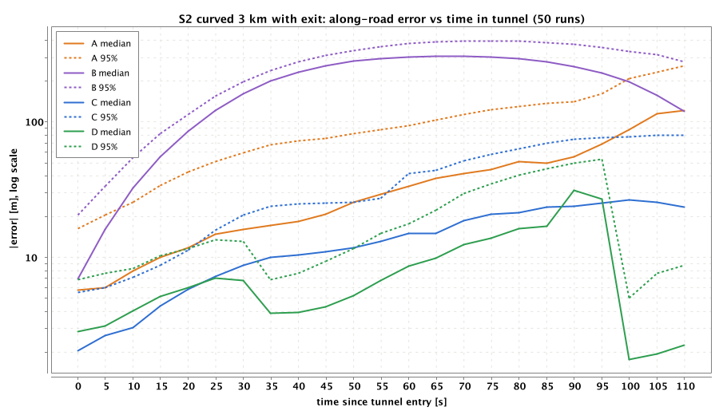
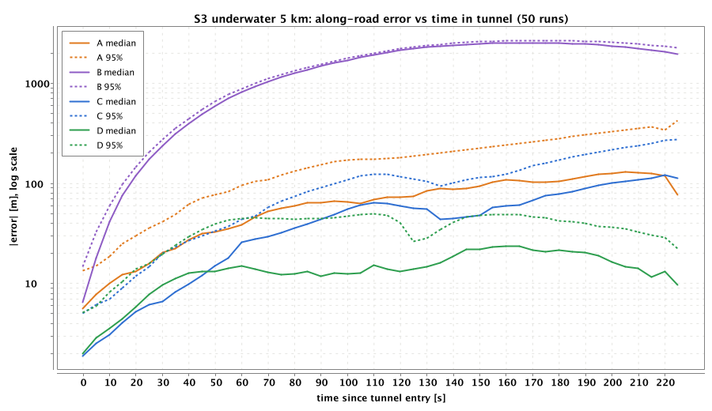
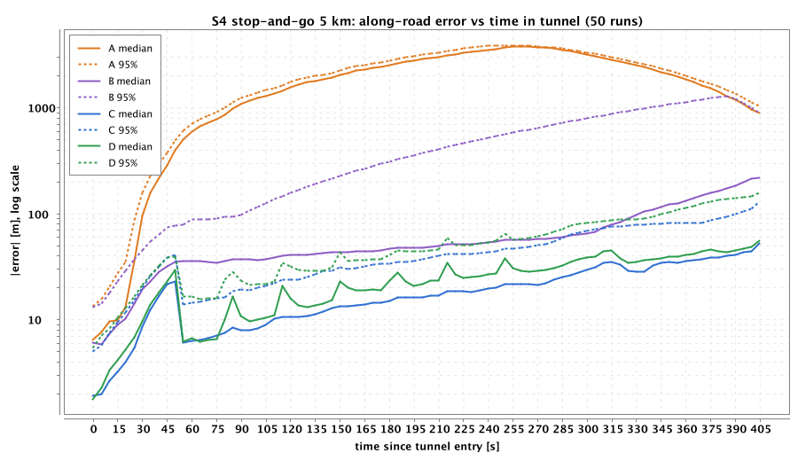
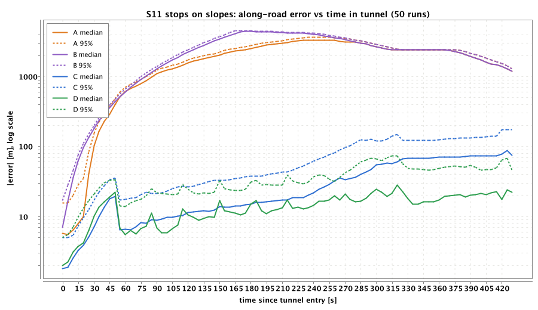
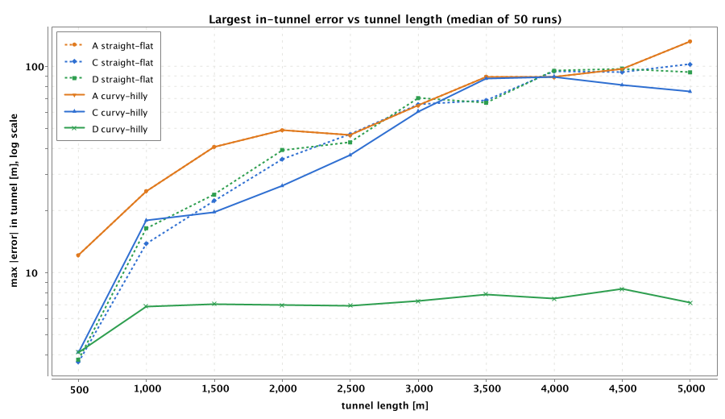
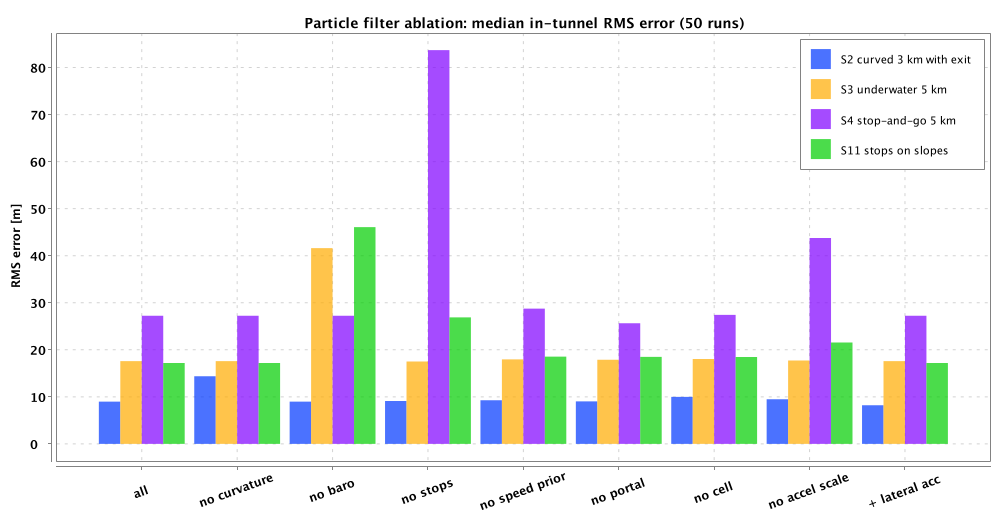

# Through the Tunnel: write-up

## 1. Summary

GPS is lost for minutes in a tunnel. Holding the last speed (what many navigation apps roughly do)
works on a free-flowing road but falls apart as soon as traffic changes speed. This write-up
proposes a **particle filter on the road network** that uses only phone sensors plus the map the
navigation app already has. Its key idea: **treat the map as the reference**. Inside the tunnel the
phone measures the shape of the road (yaw rate from the gyroscope, elevation profile from the
barometer) and stops (from vibration). The filter matches these against the map's curvature and
elevation profiles, the way aircraft navigate by matching the terrain below them.

Headline results (50 Monte Carlo runs per scenario; "rms" is along-road RMS error inside tunnels,
median / 95th percentile over runs):

| Scenario | A: constant velocity | C: map-aided EKF | **D: particle filter** | D+E |
|---|---|---|---|---|
| Scenario | A: constant velocity | C: map-aided EKF | **D: particle filter** | D+E |
|---|---|---|---|---|
| S2: curved 3 km, exit 2.1 km in | 41 / 97 m, callout 5.1 s off | 17 / 43 m, 1.7 s | **9.0 / 20 m, 0.4 s** | BLE: 3.3 / 5.9 m, 0.2 s |
| S3: underwater 5 km, ±4% | 87 / 191 m | 60 / 118 m | **18 / 29 m** | |
| S4: 5 km, 1.5 km stop-and-go | 2,258 m | 22 / 49 m | 27 / 62 m | OBD: 15 / 31 m |
| S11: stops on 3% / 2% slopes | 2,172 m | 40 / 77 m | **17 / 30 m** | |
| S6: driver misses the exit | branch known after 44 s | 44 s | **0.5 s** (95%: 3.2 s) | |
| Curvy, hilly tunnel, 500 m–5 km | max 12 → 132 m | max 4 → 89 m | **max 4–8 m at any length** | |

D is also **honest about its uncertainty**: its error stays inside its own 2σ 90–100% of the time
(95% is ideal) on every scenario except the phone-shift case.

The approach breaks down where the road carries no information: on a straight, flat tunnel the
filter falls back to dead reckoning and is no better than an EKF. It also needs road vibration to
detect stops, and a phone moved in its holder mid-tunnel is only partly handled. Section 7 covers
this.

## 2. The problem, reframed

- **It is a 1D problem.** The tunnel is single-lane and the app has the map, so the unknown is the
  distance along the road. Sideways error is removed by the map. Every error reported here is
  **along-road error**.
- **An exit inside the tunnel is a fork.** Beyond it, the estimator must also decide which branch
  the car took, and should notice when the driver misses the exit.
- **Errors are asymmetric.** A callout that comes too late makes the driver miss the exit; one that
  comes early is only an annoyance. The callout logic uses the estimate's uncertainty, not just its
  best guess.
- **Recovery is its own problem.** The first fixes after a tunnel are poor (few satellites,
  reflections off the tunnel mouth). The displayed marker should not jump, and should never move
  backwards.

## 3. Approaches

Five estimators run on identical recorded sensor data:

| ID | Approach | Idea |
|---|---|---|
| A | Constant velocity | Keep the last GNSS speed, move along the route. The baseline. |
| B | IMU dead reckoning | Integrate forward acceleration; bias calibrated against GNSS speed changes before the tunnel. No map. |
| C | Map-aided EKF | State [distance, speed, accel bias] on the planned route. Gravity correction from map grade, stop detection (zero-velocity updates), a weak speed prior from the speed limit / live traffic, tunnel-portal detection from the light sensor, cell handovers. Single hypothesis, follows the route at forks. |
| **D** | **Particle filter on the road network** | Everything C uses, plus **curvature matching** (measured yaw rate vs. particle speed × map curvature) and **barometric elevation matching**. A particle is (edge, distance, speed, accel bias, gyro scale); particles choose branches at forks, so missed exits are handled naturally. |
| D+E | D + infrastructure/vehicle data | BLE beacons in the tunnel (relevant to Pointr's beacon positioning) and/or vehicle speed from OBD-II / Android Automotive |

### How D works

1. **Alignment front-end.** The phone sits in an unknown orientation in its holder.
   - "Up" comes from gravity while the car is stopped.
   - "Forward" comes from regressing horizontal acceleration on GNSS speed changes (straight road
     only).
   - "Up" is estimated once and then frozen. Re-estimating it at later stops would absorb the
     slope the car happened to stop on.
   - The magnitude of the forward regression also gives the car's effective accelerometer scale:
     sensor scale plus the car's pitch under acceleration, about +3%.
   - Gyro spikes far above anything a car can do mean the phone was moved; the alignment is
     rotated along with the gyro.
2. **Bias calibration while GNSS is available.** A small Kalman filter calibrates the forward
   accelerometer bias against GNSS Doppler speed. Low-pass filters calibrate gyro bias, lateral
   bias and barometer offset against the map at the GNSS position. At tunnel entry the particles
   inherit these values and their uncertainty.
3. **Propagation at 10 Hz.**
   - Speed changes by forward acceleration, minus the particle's bias, minus gravity along *that
     particle's* map grade.
   - A phone cannot tell road slope from acceleration, so the slope correction depends on the
     position hypothesis: a particle in the wrong place corrects for the wrong slope and is
     penalised.
4. **Weights.**
   - Yaw rate (1 s windows) against v·κ(s) of each particle.
   - Barometric altitude against map elevation, down-weighted by the 20 s correlation time of
     in-tunnel pressure disturbances.
   - Zero-velocity when the stop detector fires.
   - Light-sensor portal events, cell handovers.
   - GNSS (heavy-tailed) outside tunnels.
   - With option E: BLE RSSI and OBD speed.
5. **Fork handling.** Particles split at forks with the route's prior (80/20). A 5% floor keeps
   each branch alive for 8 s, so the correct branch is not lost before the ramp's curve shows up
   in the gyro.
6. **Navigation layer.**
   - Callouts fire on P(remaining ≤ D) ≥ 0.2: deliberately early.
   - A reroute is raised when P(off route) ≥ 0.9.
   - The displayed marker blends towards the estimate and never moves backwards.

### Sensors considered and not used

- **Magnetometer**: dominated by tunnel steel. Simulated only to show it being ignored.
- **Wi-Fi**: tunnels rarely have it, and Android throttles scans.
- **Camera** (visual odometry): technically possible with a windscreen mount, but not standard for
  navigation apps (permissions, power, low light).
- **Microphone** (tyre noise ~ speed, tunnel reverberation): plausible, but car-specific and needs
  learned models.
- Listed as future work in §8.

## 4. Assumptions

1. A flat local metric frame, and the true map. Map errors are future work.
2. Single lane: no lane changes or overtaking. The car follows the centreline.
3. The phone is fixed in a dashboard holder at an unknown, random orientation (yaw ±15°, pitch −5
   to −25°, roll ±5° around portrait).
4. GNSS: no fix inside tunnels, and a degraded zone of 60 m around each portal. After a tunnel: a
   1–5 s reacquisition delay, then a multipath bias of 5–25 m decaying over ~6 s that the receiver's
   reported accuracy does not reflect.
5. Sensor noise values are typical consumer MEMS / phone values (see §5). They are ballpark
   figures, still to be validated against datasheets and real recordings.
6. Live traffic speeds, where a scenario provides them, are what the app believes (possibly wrong:
   S9).
7. Option E only: BLE beacons every 100 m at known (surveyed ±2 m) positions with a known path-loss
   model; OBD speed with a 1–3% scale error and 0.2 s latency.

## 5. What is simulated, and how

**Road.**
- A tree of edges built from straight, arc and clothoid segments. Grade steps are smoothed into
  vertical curves.
- Heading and elevation are integrated from curvature and grade, so the map profiles the filter
  matches are exactly consistent with the road the car drives.
- An exit inside a tunnel is a fork whose ramp starts tangential to the main road and curves away.

**Car.**
- A kinematic driver model with acceleration and jerk limits, curve speeds, slowly varying speed
  fluctuation, and scripted events: stop, stop-and-go, slow-to, hard brake, phone shift.
- Body pitch follows grade plus squat; roll follows lateral acceleration.

**Phone sensors.** True specific force and angular rate are derived from the trajectory and
rotated into the phone frame through the mount.

| Sensor | Rate | Error model |
|---|---|---|
| Accelerometer | 100 Hz | White noise 0.012 m/s², power-on bias σ 0.15 m/s², bias random walk, 1% scale, 0.5% cross-axis, temperature drift, quantisation; road vibration (0.04 + 0.006·v m/s²) or engine idle at 24 Hz |
| Gyroscope | 100 Hz | Noise 0.06°/s, bias σ 0.1°/s, random walk, 1% scale, cross-axis, vibration coupling; sees phone handling |
| GNSS | 1 Hz | Gauss–Markov error (σ 2.5 m, τ 40 s), Doppler speed σ 0.15 m/s, degraded zone, reacquisition delay, exit multipath, optimistic reported accuracy; C/N0 and satellite count (Android) |
| Barometer | 25 Hz | 3 Pa noise, unknown weather offset, drift; in tunnels: entry step, piston-effect fluctuation (σ 4 Pa, τ 25 s), ventilation spikes |
| Ambient light | 5 Hz | Daylight, graded entrance lighting, daylight leak at portals, ceiling-light pattern, sensor lag (Android only) |
| Magnetometer | 10 Hz | Earth field + car hard iron; strong position-dependent disturbance in tunnels |
| Cell | events | Handovers at in-tunnel coverage zones, ±60 m jitter, 10% missed (Android only) |
| BLE (E) | 1 Hz scans | Log-distance path loss (n = 2.2), correlated shadowing σ 5 dB, detection probability, dead beacons |
| OBD (E) | 5 Hz | Scale error 1–3%, 1 km/h quantisation, 0.2 s latency |

Device profiles: **GENERIC** (all of the above), **IOS** (no raw GNSS, no light, no cell), **LOW_END**
(no barometer, 2× IMU errors).

**Evaluation.**
- Each run is deterministic for a seed: one random stream per component.
- Monte Carlo varies everything with the seed: driver, phone mount, every sensor error, estimator
  randomness.
- Metrics:
  - along-road error inside tunnels and at the exit
  - callout timing (true remaining distance when each callout fires)
  - branch decision time and reroute latency
  - recovery time after GNSS returns
  - **consistency**: the share of tunnel time the error lies within the estimator's claimed 2σ
    (95% is ideal), and NEES.

## 6. Results

All numbers are from `./gradlew :sim-batch:run --args="study all -n 50"`. The full tables are in
`results/curves/summary.csv` and the other `results/*/*.csv` files; figures are in `docs/figures/`.

### 6.1 Error over time in the tunnel

S2 (curved 3 km tunnel, exit 2.1 km in):
- Constant velocity (A) drifts with the driver's speed changes.
- IMU dead reckoning (B) is ruined by the −3% / +2% grades: a phone cannot tell slope from
  acceleration, and 3% of gravity is 0.3 m/s².
- The EKF (C) fixes the grade with the map but still drifts.
- D stays at a few metres through the curve. Its error grows on the 1.3 km straight before the
  fork, peaks right at the fork, and drops sharply when the ramp's curve re-anchors it.
- Callouts: D's median timing error is 0.4 s (95%: 1.7 s), against 5.1 s for A and 1.7 s for C. A,
  C and D had no late callouts in any run; B was late in most callouts.

S3 (5 km underwater tunnel, 100 m deep): B is useless because it doesn't correct for grade. The
barometer's elevation profile keeps D at 18 m rms, against 42 m for the same filter without the
barometer (§6.3).

S4 (stop-and-go traffic):
- Constant velocity fails completely: the marker runs 3.8 km ahead of the car.
- C and D are equivalent (22 and 27 m rms). The road has no shape, so the particle filter has
  nothing extra to match.
- What keeps both in check:
  - **Stop detection**: every detected stop resets the speed error (without it, D: 84 m).
  - **The per-car accelerometer scale**: without it, D: 44 m. Every accelerate/brake cycle
    integrates the scale error.
  - **A fixed "up" axis**: before this fix, D was at 53 m (§7).

S11 (stop-and-go on a 3% climb, a full stop on a 2% descent) exists because of a flaw found during
the evaluation. Re-estimating "up" at a stop on a slope counts the slope twice, and errors reached
2 km. With "up" frozen, D gets 17 m rms and C 40 m. Here the barometer helps D on the slopes.

### 6.2 Tunnel length

Generated tunnels from 500 m to 5 km, on a featureless straight, flat road (dashed) and on a curvy,
hilly road (solid):
- **On the curvy, hilly road, D's largest error stays at 4–8 m whatever the length.** The road
  shape keeps re-anchoring it.
- On the featureless road every approach drifts, to roughly 90–130 m at 5 km. In steady free flow,
  constant velocity is about as good as anything: the driver's speed simply doesn't change much.
  (A's two lines coincide: these curves don't change the driver's speed.)
- Error *at the exit* is not shown: the light sensor detects the portal and snaps C and D back to
  it just before the car leaves, which would make them look better than they are.

### 6.3 Which sensors matter (ablation of D)

Median in-tunnel rms over 50 runs:

| Removed | S2 curved | S3 underwater | S4 jam | S11 slopes |
|---|---|---|---|---|
| nothing | 9.0 m | 17.6 m | 27.3 m | 17.2 m |
| curvature matching | **14.4 m** | 17.6 m | 27.3 m | 17.2 m |
| barometer | 9.0 m | **41.6 m** | 27.3 m | **46.1 m** |
| stop detection | 9.1 m | 17.5 m | **83.7 m** | **26.9 m** |
| accelerometer scale | 9.5 m | 17.7 m | **43.8 m** | 21.5 m |
| speed prior / portal / cell | ±1 m | ±0.5 m | ±2 m | ±1.5 m |

Each scenario is carried by one sensor that matches its road:
- the gyro in curves
- the barometer on grades
- stop detection plus the accelerometer scale in traffic

Light-sensor portals and cell handovers change little here, because GNSS returns at the exit anyway.
Lateral acceleration is within noise and is biased by body roll, so it is off by default.

### 6.4 Branch choice, reroute and recovery

- S6 (driver misses the exit): D decides the branch **0.5 s** after the fork (95%: 3.2 s), from the
  ramp's curve the gyro *doesn't* see. A, B and C follow the planned ramp until GNSS returns at the
  tunnel exit, 44 s later, and show the car on the wrong road for 1.8 km.
- With three cars (S10), D handles the fast car, the cautious one that stops, and the one that
  misses the exit: median rms 13 m against 29 m for C. C's 95% case is 565 m, from the missed exit.
- Recovery: after GNSS returns, all estimators are within 10 m in a few seconds. The display
  smoother never moves the marker backwards. Heavy-tailed GNSS likelihoods plus inflated noise for
  the first fixes absorb the 5–25 m multipath at the exit.

### 6.5 Phone profiles and option E

| | S2 rms (median / 95%) | S3 rms |
|---|---|---|
| Generic Android | 9.0 / 20 m | 17.6 / 29 m |
| iOS (no raw GNSS, light or cell) | 8.8 / 19 m | 18.3 / 29 m |
| Low-end (no barometer, 2× IMU error) | 10.4 / 20 m | **44.7 / 75 m** |

- An iPhone loses almost nothing in these scenarios.
- A phone without a barometer loses the elevation profile, which is what makes long underwater
  tunnels work.
- BLE beacons every 100 m bring D+E to 3.3 m rms and a 0.2 s callout error. With 30% of the beacons
  dead it is still 4.2 m.
- OBD speed in the jam brings D to 15 m.

### 6.6 Cost

1,000 particles take about 0.7–1.5 s of CPU for a 4-minute drive on a laptop (~3–6 ms per second
of driving, depending on load). Accuracy is flat from 300 to 3,000 particles; 100 particles is
slightly worse and less consistent.

## 7. Where it breaks, and why

1. **Roads without shape.** On a straight, flat tunnel D has nothing to match. It becomes an
   accelerometer-plus-stops dead reckoner, no better than the EKF. The error grows with time:
   roughly 40 m after 2 km and 90–130 m after 5 km in free flow (§6.2). The same happens on the
   1.3 km straight before the S2 fork, which is where D's S2 error peaks. This is the method's
   fundamental limit, not a tuning issue.
2. **Stop-and-go traffic on a featureless road** (S4, S9): median 22–31 m rms, with 95th-percentile
   worst cases of ~120–150 m.
   - Every accelerate/brake cycle integrates the residual scale and bias errors. Stop detection
     removes the speed error at each stop, but not the distance already lost.
   - A wrong traffic report (S9) barely matters because the speed prior is deliberately weak.
   - Vehicle speed (OBD) helps most in this case.
   - Before the fixes in §6.1 (frozen "up", per-car scale) this case was twice as bad, and stops on
     slopes were catastrophic. Both problems were found by asking why the estimated speed drifted
     in the jam.
3. **Stop detection needs road vibration.** It recognises a stopped car by the absence of road
   vibration. With road vibration almost switched off in a test, it reported "stopped" while the
   car was moving, and errors went to kilometres. Very smooth roads, well-damped holders or quiet
   EVs need real-data validation.
4. **The phone moving in its holder** (S7, 27° rotation mid-tunnel). The gyro-tracked alignment ends
   up about 4° off, and the residual tilt leaks gravity into the forward axis.
   - After the change, D widens its bias uncertainty and the map re-anchors it on the following
     grade and ramp curve: median 45 m rms.
   - The 95% case is 178 m, and D is over-confident (NEES 73).
   - Detecting phone handling and *saying* "position uncertain" is probably the honest product
     answer.
5. **The accelerometer scale needs accelerations with GNSS.** Before the tunnel there may be only
   one pull-away to learn from, which makes the estimate noisy (±2.7% across runs, against an
   effect of ~3%). It is therefore shrunk towards zero by its own uncertainty. On real roads more
   acceleration events precede most tunnels.
6. **Option E consistency.** D+E with OBD is accurate but over-confident in stop-and-go traffic (in
   2σ only 60% of the time). Speedometer quantisation and latency are correlated errors that the
   likelihood still treats too optimistically.

**Failure modes found during development, and their fixes.** These are worth knowing for anyone
building this; `docs/DESIGN.md` §14 has the evidence for each.
- Per-particle nuisance parameters cause "genetic drift" of the cloud's mean speed.
- Clamping speed at zero biases the bias estimate at every stop.
- A barometer treated as independent at 2 Hz makes the filter 7× over-confident.
- Alignment regression run in curves rotates the forward axis by degrees.
- Re-estimating "up" at stops counts the slope twice.

## 8. Limitations of this study

- **The simulator shares the estimator's assumptions.** The map is perfect, the sensor models are
  the ones the filter was designed for, and noise levels are ballpark. Real data will be less
  kind. The largest gaps are probably map curvature/elevation errors, IMU behaviour under real
  road vibration, and barometer behaviour in real tunnels with ventilation.
- **The driver model is simple.** Real stop-and-go traffic is less regular, and creeping at very
  low speed is the hardest case for the stop detector.
- **Single lane, no overtaking**, as specified. Multi-lane tunnels would add lane-level questions
  this work does not address.
- **Tuning was done on the same simulator** that evaluates it. Section 14 of the design doc lists
  every change and the evidence for it. A real-data validation set is the necessary next step.

## 9. What I would do next with real devices

1. **Record real traces.** Drive real tunnels with several phones (Android and iPhone) in common
   holders, logging raw IMU, barometer, GNSS raw measurements, light and cell. Use an RTK GNSS +
   wheel-odometry reference system for ground truth, or surveyed tunnel landmarks. The
   `SensorLog` format is designed so recorded data replays through the same estimators.
2. **Validate the sensor models**, especially the ones the filter leans on:
   - gyro scale and bias stability at vehicle vibration levels
   - in-tunnel pressure behaviour (piston effect, ventilation)
   - the stop detector on real cars, including EVs and smooth roads
   - real map quality: curvature and elevation from OpenStreetMap / HERE / TomTom vs. surveyed
3. **Learn from the fleet.** Crowd-sourced traversals can build tunnel-specific profiles: measured
   curvature and elevation, typical speeds, portal positions, cell handover points, even magnetic
   fingerprints.
4. **Product work.**
   - Battery: 100 Hz IMU for minutes is fine, but cost the filter on low-end phones (1,000
     particles take ~2–4 ms per second of driving here).
   - Adaptive particle count.
   - A/B test callout policies on real drivers.
5. **Infrastructure.** Where tunnels have BLE beacons (Waze Beacons, or Pointr deployments), D+E
   brings errors to a few metres and makes the callout essentially exact.
6. **Extra phone sources worth testing.** Speed from tyre/road noise on the microphone,
   rear-camera visual odometry where permitted, and vehicle speed through Android Automotive APIs.
